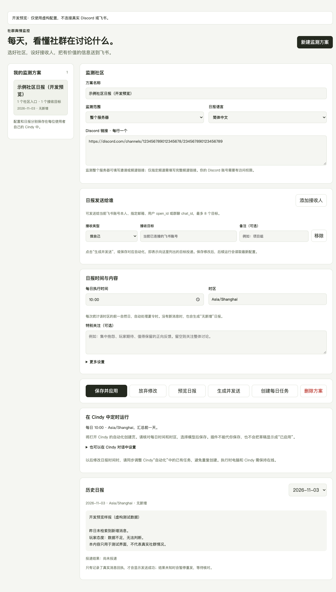
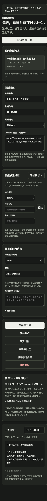
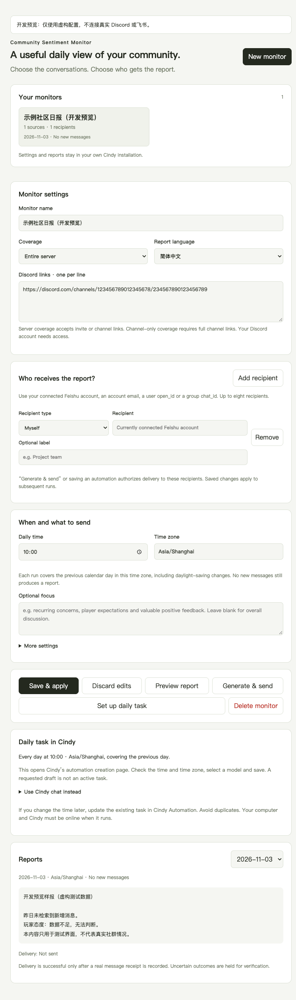

# 社群舆情监控

一个可自主配置的 **Cindy 插件**：读取 Discord 社群讨论，生成有证据、可回溯的中文或英文日报，再发送给指定的飞书个人或群聊。

**[下载 .cindy 安装包](https://github.com/jiangdebing7-coder/community-sentiment-monitor/releases/latest)**

## 能做什么

- 管理多个监测方案，每个方案配置 1–8 个 Discord 社群入口或频道。
- 选择整个服务器，或只读取指定频道。
- 配置日报时间、IANA 时区、关注事项与报告语言；按前一自然日统计，处理夏令时。
- 自主选择接收人：自己、飞书账号邮箱、用户 open_id、群聊 chat_id；每个方案最多 8 个目标。
- 一键预览，或生成并发送；无新增也能生成日报。
- 在插件内查看历史日报和逐目标发送状态，保留真实回执。
- 对重复运行、部分目标失败和结果未知分别处理，避免把已收到的日报再次推送。
- 中英文界面随 Cindy 语言切换，支持浅色、深色与窄屏。

第一版支持 **Discord → 飞书**。每位使用者使用自己的模型、Discord 登录状态及飞书连接，安装包中没有预置社区、个人账号、日报记录或密钥。

## 安装与开始使用

1. 使用 **Cindy 0.1.121 或更高版本**，从 Releases 下载 .cindy 文件并导入 Cindy。
2. 核对并允许插件声明的能力：保存自己的配置和报告、创建可见的 Cindy 任务、请求打开原生自动化创建页、显示报告未读角标。
3. 打开“社群舆情监控”，新建方案，填写 Discord 链接、范围、日报时间、时区及飞书接收目标，点击“保存并应用”。
4. 在 Cindy 使用的浏览器中登录有权查看相应社群的 Discord 账号；连接使用者自己的飞书插件账号。仅发本人时，也可使用已经完成主人绑定的 Cindy 飞书机器人。
5. 先点“预览日报”。确认读取的是所需社区、日期和讨论后，再点“生成并发送”。
6. 需要每天执行时，使用下面的定时配置步骤。

无需另装 Node、提供模型 API key 或部署独立后台服务。开发命令所需的 Node 仅用于维护源码和测试。

## 定时日报

有两种原生使用方式：

**从插件界面创建**：点击“创建每日任务”，Cindy 会收到一份自动化草稿。请在原生创建页核对每天的执行时间、时区和模型，然后保存。插件中设置的时间会写在建议与指令里；当前宿主草稿 API 不接收 cron/timezone，仍需在创建页核对一次。草稿请求成功不等于自动化已启用。

**从 Cindy 对话创建**：展开“也可以在 Cindy 对话中设置”，复制生成的指令到普通 Cindy 对话。Agent 会读取 prepare_schedule 返回的准确 cron 和时区，用 Cindy 原生调度工具创建或修改对应任务。

每次运行都重新读取社区及接收人配置。修改来源或接收目标后，后续运行使用新配置；修改执行时间时，请同步调整 Cindy“自动化”中的既有任务。暂停、删除、运行记录及实际下次时间也在该页面管理。

**电脑和 Cindy 需要在执行时在线。** 本插件不提供关机后运行的云端调度。

## 社区链接与接收人

| 配置 | 填写方式 |
| --- | --- |
| 整个 Discord 服务器 | 邀请链接或该服务器的完整频道链接 |
| 指定频道 | discord.com/channels/服务器ID/频道ID；每行一个 |
| 我自己 | 选择“我自己”，运行时核对当前连接的飞书账号 |
| 指定个人 | 选择“飞书账号邮箱”或“用户 open_id”并填写对应值 |
| 指定群聊 | 填写 oc_ 开头的 chat_id，或包含 openChatId 的官方飞书会话链接 |

填写社区名称不会自动授予访问权限。邀请链接只定位社群，读取消息依赖使用者自己的账号权限。无法读取、索引延迟、达到分页上限和图片未分析等情况会在报告中说明。

## 日报如何表达

正常日报包含当天重点、主要主题、态度与分歧、声量与参与人数、有价值的新线索、可比较的趋势、少量跟进建议及原消息链接。

- 公告、机器人转发与玩家讨论分开归纳。
- 没有可靠数据时不编造人数、情绪比例或增长率。
- 观点、待核实说法与事实分开表述。
- 成功读取且没有消息时显示“无新增”；读取失败显示“采集未完成”。
- 成功发送需要记录实际消息回执；发送结果未知时保留待核对，不自动重发。

## 数据与授权

配置使用 Cindy 为该安装实例隔离的 KV，完整报告与投递记录使用插件私有数据目录。历史保留可设为 7–120 天，默认 90 天；在途及未知投递记录不会自动清理。卸载插件会移除该安装的私有数据。

插件没有独立的网络或模型凭据，依靠使用者已经认可的 Cindy 模型及连接器执行工作。保存配置不立即发送；“生成并发送”或用户保存的自动化才是对应的投递动作。所有任务可在 Cindy 中查看和停止。

## 界面

以下截图来自开发预览，使用虚构配置，不连接真实 Discord 或飞书。



<details><summary>查看 320 px 深色界面和英文界面</summary>




</details>

## 开发与验证

运行环境零 npm 依赖。使用 Node 20+：

```sh
npm test
npm run check
npm run preview
```

预览仅在 127.0.0.1 启动模拟宿主，不执行真实消息读取或投递。界面烟测使用独立的临时 Chrome 配置，不读取日常浏览器账号：

```sh
node dev/ui-smoke.mjs
```

macOS 默认使用已安装的 Google Chrome；其他环境可通过 CHROME_PATH 指定 Chrome/Chromium 可执行文件。界面测试截图写入 docs/screenshots。

核心逻辑测试覆盖来源与目标校验、配置冲突、时区和夏令时、暂停或删除、并发投递占用、部分失败、未知结果、存储失败与历史保留。界面测试使用模拟宿主，不能替代导入后各使用者的真实账号授权和首次试跑。

打包使用 Cindy 的 ghost_forge_pack；打包不会安装插件。源码与宿主 API 核对记录见 [SOURCE_VERIFICATION.md](SOURCE_VERIFICATION.md)，Agent 完整执行流程见 [随包手册](manual/daily-report/MANUAL.md)。

图标：本版采用 Forge 默认图标。AI 图标生成服务拒绝了请求尺寸，按创建规范未重复生成。

## English

Community Sentiment Monitor is a configurable Cindy plugin for Discord daily reports delivered to Feishu people or chats. Each installation starts empty and uses its owner's existing Cindy model and connected accounts. It includes previews, native automation drafts, per-recipient delivery receipts and duplicate protection. A running computer and Cindy are required; automation drafts must be reviewed and saved in Cindy.
